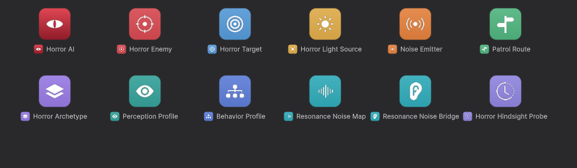

# Horror AI Manager

Enemy AI for horror games: enemies that see, hear and remember, where light and darkness decide whether you are
spotted.

## Start here

- [Getting started](getting-started.md): an enemy hunting you in five steps, with the buttons that do the work.
- [The dashboard](dashboard.md): **Tools > Horror AI > Dashboard**, every enemy live, the noises, the scene checks
  and the archetypes.

## How it works

- [Components](components.md): Horror Enemy, Horror Target, Horror Light Source, Noise Emitter, Patrol Route.
- [Perception](perception.md): sight and the suspicion gauge, detection times, light, crouching, hearing, memory.
- [Noises](noises.md): making noise from code or props, what enemies hear through walls.
- [Behavior](behavior.md): the state machine, what makes an enemy change its mind, and the events.
- [Patrol routes](patrol-routes.md): waypoints, waits and modes.
- [Archetypes and presets](archetypes.md): Perception Profile, Behavior Profile, Horror Archetype, Patroller.

## Going further

- [Debugging](debugging.md): Scene view gizmos, the dashboard and the live inspectors.
- [Scripting](scripting.md): `HorrorAI`, `HorrorEnemy` and the events from code.
- [Integrations](integrations.md): Resonance sounds heard by enemies, Hindsight recordings of their state.
- [Performance and how it works](performance.md): time slicing, the raycast budget, zero allocation, benchmark.
- [Limitations, troubleshooting and FAQ](troubleshooting.md).

## Icons

Every component and asset has its own icon in the Inspector, the Project window and the Add Component menu:

