<p align="center">
  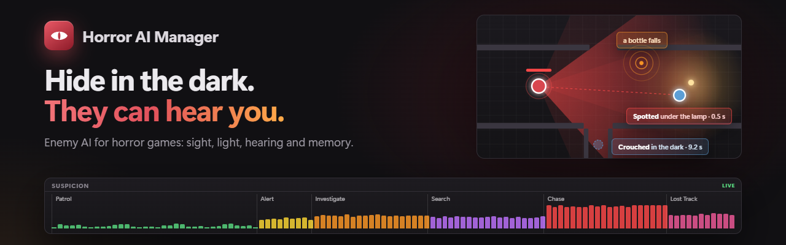
</p>

<p align="center">
  <a href="https://github.com/Nekuzaky/Unity-Horror-AI-Manager/actions/workflows/tests.yml"></a>
  
  
  
  
  
  
  <a href="LICENSE"></a>
</p>

<p align="center">
  <a href="https://github.com/sponsors/Nekuzaky"></a>
  <a href="https://www.patreon.com/Nekuzaky"></a>
  <a href="https://buymeacoffee.com/nekuzaky"></a>
</p>

**Horror AI Manager** is enemy AI for horror games in Unity. Your monsters see with a view cone and a suspicion
gauge, hear your footsteps through walls, remember where you were, and patrol, investigate, search and chase you.
**Light matters:** a player in the dark is noticed slowly, a player under a lamp or holding a flashlight is spotted at
once, and crouching behind a crate actually hides you.

**Hide in the dark. Hold your breath. Do not run.**

<p align="center">
  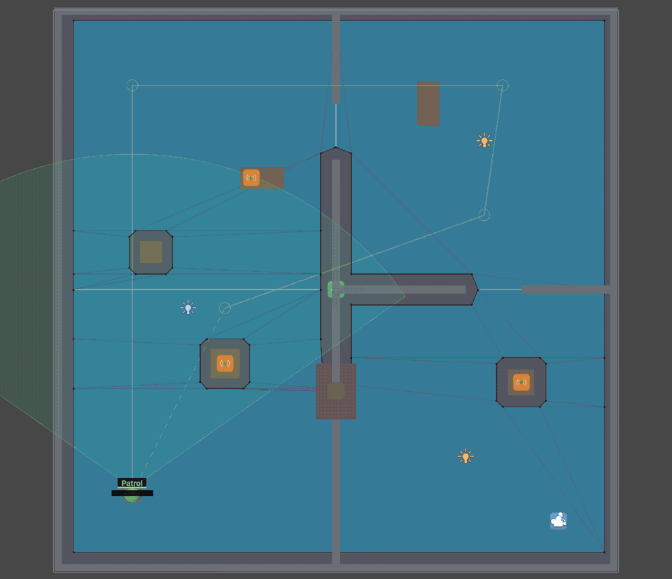
</p>

<p align="center"><sub>The greybox demo from above, with the Scene view gizmos. The enemy patrols (green), hears a bottle
fall (yellow, then orange as it goes to check), searches (purple), spots the player walking under the hall lamp and
chases (red), then loses the trail (pink) when the player runs behind the walls, and goes back to searching.
<a href="docs/images/horror-ai-demo.mp4">MP4</a></sub></p>

## Why

Every horror game needs the same enemy: one that walks its round, stops when it hears a bottle fall, comes to check,
searches the room, and gives up just as you were about to scream. Writing it is easy; making it fair is not. An enemy
that sees you through the dark the instant you enter its cone is not scary, it is frustrating. Horror AI Manager gives
you that enemy, tuned for stealth horror, in a few components, with events for every scare and a dashboard that tells
you *why* the monster did what it did.

## Features

- **Sight with a suspicion gauge.** A view cone and up to four rays to points on the target's body. The gauge fills
  fast when the target is close, lit and fully visible, slowly when it is far, in the dark or half hidden.
- **Light matters, without reading the render.** Mark lamps and flashlights with a `Horror Light Source`: exposure is
  estimated from them (distance, beam cone, an occlusion ray), the same with the built-in pipeline, URP and HDRP. A
  marked moon lights everyone under the open sky; a flashlight makes its holder visible from afar.
- **Crouching** lowers the points enemies look at (low cover hides you) and slows the gauge.
- **Hearing through walls.** `HorrorAI.EmitNoise(position, loudness, source)` or a `Noise Emitter` on props that
  clatter. Noise fades with distance and each wall in the way damps it.
- **Memory.** The last known position, when, and how sure the enemy is.
- **A deterministic state machine.** Patrol, Alert, Investigate, Search, Chase, Lost Track, with every threshold,
  duration and speed in assets, and each change of mind explained in plain words.
- **Events for every scare.** *Spotted*, *chase started*, *caught*, *lost track*, *gave up*, *noise heard*... as Unity
  Events and C# events: hook sounds, music and jump scares without code.
- **A live dashboard.** **Tools > Horror AI > Dashboard**: enemies by state, cost per frame, rays against the budget,
  measured garbage, 30-second graphs; each enemy's perception, memory and history of changes of mind; the noises and
  who heard them through which walls; a Setup tab that checks the scene and fixes it in one click; the archetypes in
  plain words. Nothing of it exists in a build.
- **Plain-word inspectors with one-click fixes.** *There is no NavMesh under this enemy* → **Bake a NavMesh**.
- **Icons for everything**: each component and asset has its own icon in the Inspector, the Project window and the Add
  Component menu.
- **Built for many enemies.** Perception spread over frames, a global raycast budget, and nothing allocated per frame,
  measured with Unity's profiler counters: fifty enemies cost 0.043 ms per frame.
- **Optional integrations** with [Resonance](https://github.com/Nekuzaky/Resonance) (its sounds are heard by enemies)
  and [Hindsight](https://github.com/Nekuzaky/Hindsight) (records each enemy's state and bookmarks every change of mind).

<table>
  <tr>
    <td width="50%">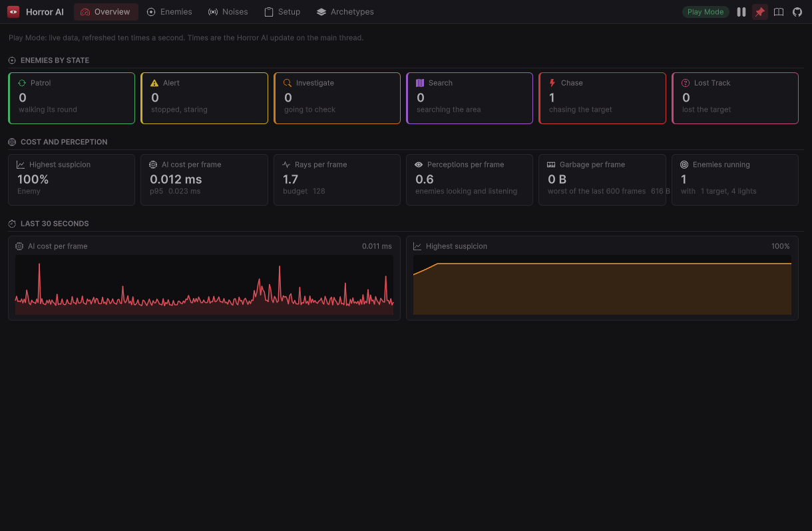<br><sub><b>Overview.</b> Enemies by state, cost, rays, garbage and the last 30 seconds.</sub></td>
    <td width="50%">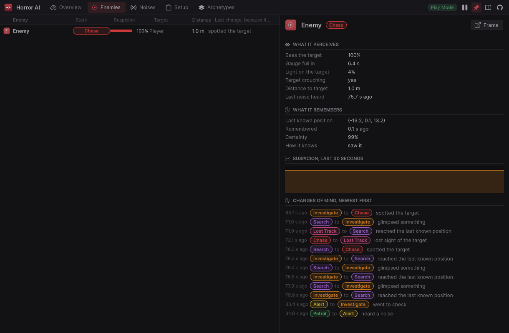<br><sub><b>Enemies.</b> What the picked enemy perceives, remembers, and why it changed its mind.</sub></td>
  </tr>
  <tr>
    <td>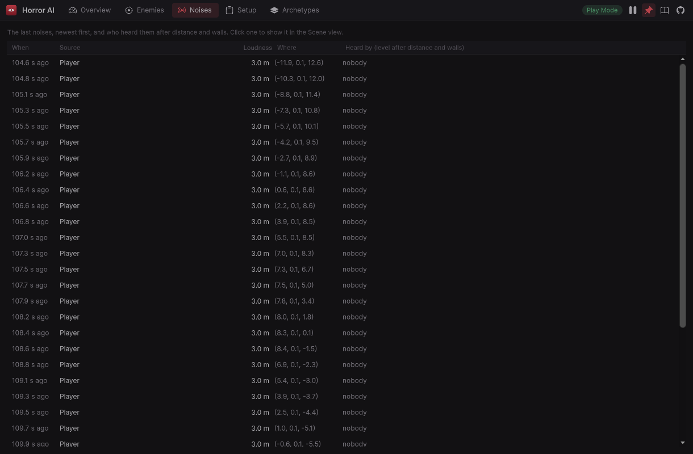<br><sub><b>Noises.</b> Every noise, who heard it and how loud after the walls.</sub></td>
    <td>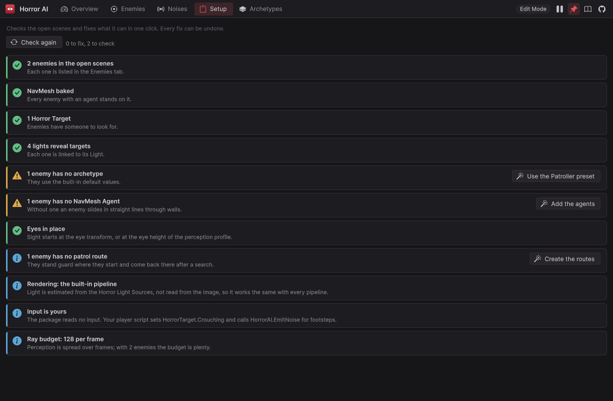<br><sub><b>Setup.</b> The scene checked, with one-click fixes.</sub></td>
  </tr>
  <tr>
    <td>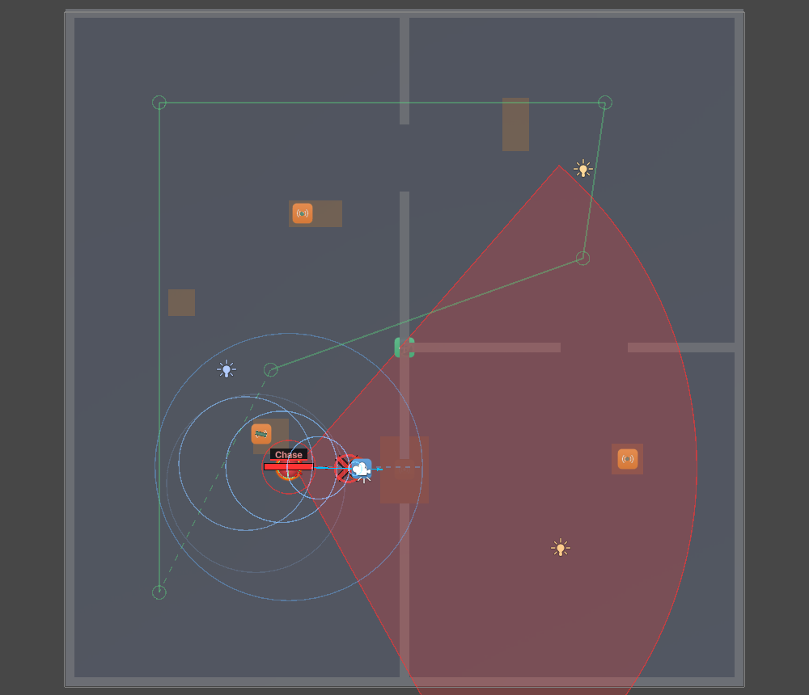<br><sub><b>Gizmos.</b> View cone in the state color, hearing radius, suspicion bar, last known position.</sub></td>
    <td>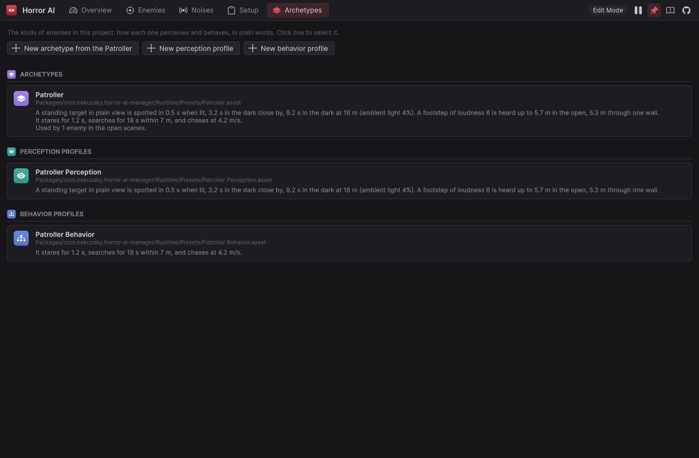<br><sub><b>Archetypes.</b> Detection times and behavior in plain words.</sub></td>
  </tr>
  <tr>
    <td>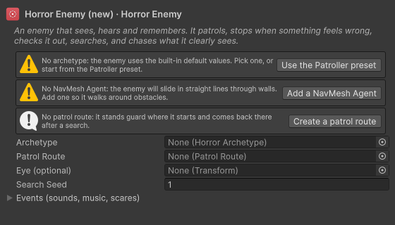<br><sub><b>Inspectors</b> say what is missing and fix it.</sub></td>
    <td>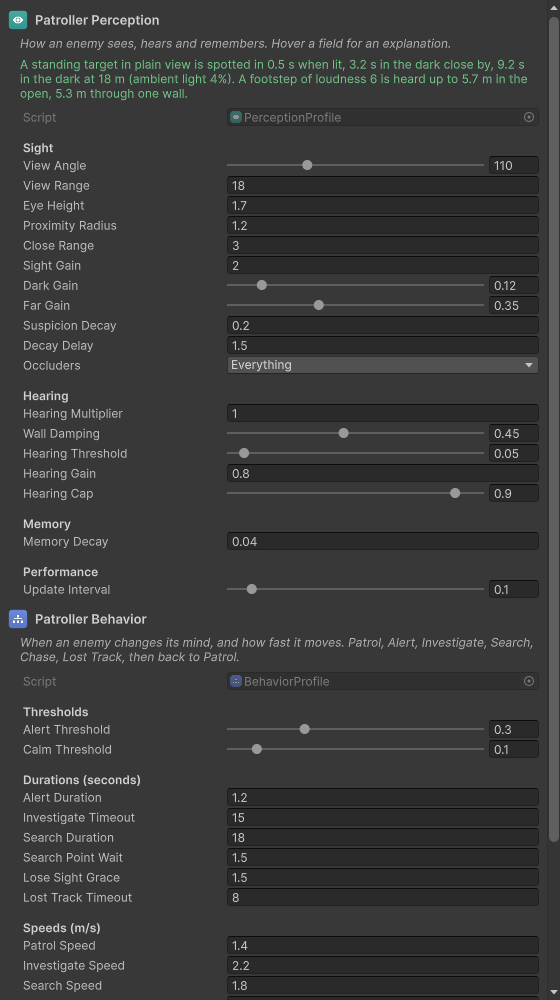<br><sub><b>Profiles</b> summarize their numbers in seconds and meters.</sub></td>
  </tr>
</table>

<p align="center">
  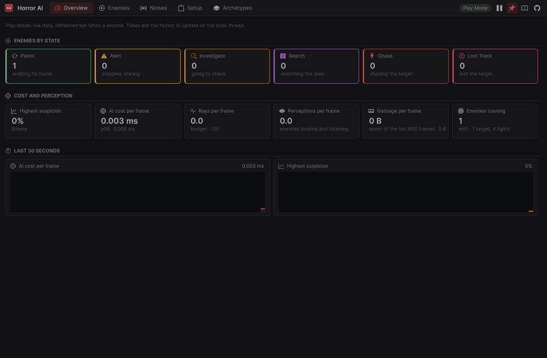
</p>

## Install

Requires **Unity 6000.3** or newer (Unity 6.3 LTS) and the **AI Navigation** package (installed automatically).
Works with the built-in pipeline, URP and HDRP.

In Unity: **Window > Package Manager > + > Install package from git URL...** and paste:

```
https://github.com/Nekuzaky/Unity-Horror-AI-Manager.git?path=/Packages/com.nekuzaky.horror-ai-manager
```

Pin a release by adding its tag, for example `...?path=/Packages/com.nekuzaky.horror-ai-manager#v0.1.0`.

## Quick start

1. **GameObject > Horror AI > Enemy.** It comes with a NavMesh Agent and the Patroller archetype.
2. Follow its inspector, or the dashboard's **Setup** tab: **Bake a NavMesh**, **Add a Horror Target to the player**,
   **Create a patrol route**, **Mark every light**.
   <br>
3. Put a **Horror Light Source** with **Reveals Its Holder** on the player's flashlight, and make noise on footsteps:
   `HorrorAI.EmitNoise(transform.position, running ? 10f : 4f, gameObject)`.
   <br>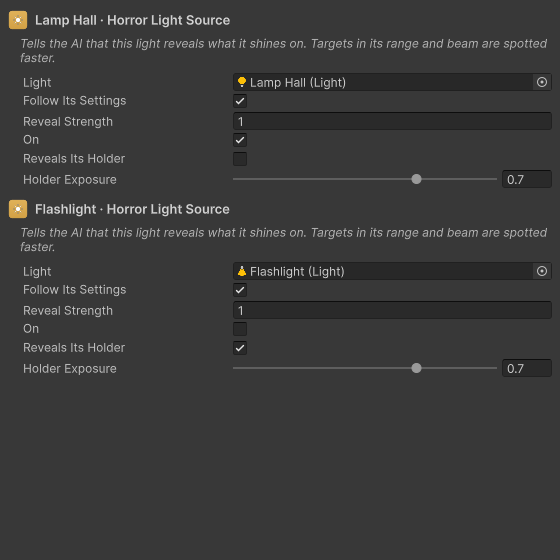
4. Hook your scares to the enemy's **Events** (On Spotted, On Chase Started, On Caught...).
5. Press Play and open **Tools > Horror AI > Dashboard** (Ctrl+Shift+Alt+H).

To try it first, import the **Greybox Demo** from the package's **Samples** tab: a dark level, three lamps, bottles
that clatter, a creaky floor and one patrolling enemy. WASD, Shift to run, C to crouch, F for the flashlight.

## Components

| | Component | Put it on | What it does |
|---|---|---|---|
|  | `Horror Enemy` | Each monster (with a `NavMesh Agent`) | Sees, hears, remembers and runs the state machine. Holds the events. |
|  | `Horror Target` | The player | What enemies look for. `Crouching`, visibility, body points. |
|  | `Horror Light Source` | Lamps, torches, the flashlight, the moon | Reveals targets in its range and beam. Follows a `Light`, or set by hand. |
|  | `Noise Emitter` | Props, floors, triggers | Makes a noise on collision, trigger, start, or when `Emit()` is called. |
|  | `Patrol Route` | An empty object with waypoint children | Loop, ping-pong or once, with a wait per waypoint. |
|  | `Horror Archetype` | Asset | A kind of enemy: a Perception Profile plus a Behavior Profile. |
|  | `Perception Profile` | Asset | How it sees, hears and remembers. |
|  | `Behavior Profile` | Asset | When it changes its mind, and how fast it moves. |

## Scripting

```csharp
using Nekuzaky.HorrorAI;
using UnityEngine;

public class Footsteps : MonoBehaviour
{
    public HorrorTarget target;

    void OnStep(bool running) =>
        HorrorAI.EmitNoise(transform.position, target.Crouching ? 1.5f : running ? 10f : 4f, gameObject);
}

public class ChaseMusic : MonoBehaviour
{
    void OnEnable() => HorrorAI.StateChanged += OnStateChanged;
    void OnDisable() => HorrorAI.StateChanged -= OnStateChanged;

    void OnStateChanged(HorrorEnemy enemy, HorrorTransition change)
    {
        if (change.To == HorrorState.Chase) Debug.Log($"{enemy.name} {change.Explanation}");   // "spotted the target"
    }
}
```

`HorrorEnemy` exposes `State`, `Suspicion`, `Memory`, `Perception`, `LastTransition`, `Target`, and
`Investigate(position)` (lure it somewhere) and `Calm()` (send it back to its patrol). See
[Scripting](Packages/com.nekuzaky.horror-ai-manager/Documentation~/scripting.md).

## Performance

Measured in real Play Mode with `Tools/Benchmark.ps1`: 50 NavMesh enemies around one moving target, 1,800 frames per
scenario at 60 fps after 120 warm-up frames, Intel Core i7-14700KF, Unity 6000.3.13f1.

| Scenario | Horror AI per frame (avg / p95 / max) | Raycasts per frame | Perceptions per frame | GC allocated by the update |
|---|---:|---:|---:|---:|
| 50 enemies, lit scene (8 lamps + flashlight) | 0.043 / 0.057 / 0.808 ms | 12.0 | 8.3 | 0 B in 1,800 frames |
| 50 enemies, dark scene (lights off) | 0.043 / 0.057 / 0.653 ms | 11.8 | 8.3 | 0 B in 1,800 frames |

The time covers the whole Horror AI update on the main thread: light exposure, sight and hearing raycasts, the state
machines and the NavMesh destinations they set. The garbage is read every frame from Unity's profiler. A Windows
development player of the demo, checked by `Tools/Build-Check.ps1`, also allocates 0 B and holds only the runtime
assembly. **The dashboard costs nothing in a build:** it lives in the editor assembly, and the three calls the runtime
makes to it are removed by the compiler outside the Editor (the build check finds none in the player's assembly); with
the window closed, each is a null check in the Editor. More in
[Performance](Packages/com.nekuzaky.horror-ai-manager/Documentation~/performance.md) and
[What the dashboard costs](Packages/com.nekuzaky.horror-ai-manager/Documentation~/dashboard.md#what-it-costs).

## How it works, in short

Each enemy perceives ten times a second, spread over frames so the cost stays flat. A perception casts at most four
sight rays to the target's body and one ray per noise to count the walls; a global budget caps the rays per frame and
defers the rest fairly. Light exposure is computed per target from the marked lights, not per enemy. What the enemy
perceived feeds a suspicion gauge and a memory, and a small deterministic state machine turns them into behavior and
events, with a reason in plain words for every change. Everything is preallocated: the first enemy that registers runs
every code path once, so nothing is compiled or allocated in the middle of a game.

## Documentation

- [Getting started](Packages/com.nekuzaky.horror-ai-manager/Documentation~/getting-started.md)
- [The dashboard](Packages/com.nekuzaky.horror-ai-manager/Documentation~/dashboard.md)
- [Components](Packages/com.nekuzaky.horror-ai-manager/Documentation~/components.md)
- [Perception: sight, light, crouching, hearing, memory, detection times](Packages/com.nekuzaky.horror-ai-manager/Documentation~/perception.md)
- [Noises](Packages/com.nekuzaky.horror-ai-manager/Documentation~/noises.md)
- [Behavior: the state machine and its events](Packages/com.nekuzaky.horror-ai-manager/Documentation~/behavior.md)
- [Patrol routes](Packages/com.nekuzaky.horror-ai-manager/Documentation~/patrol-routes.md)
- [Archetypes and presets](Packages/com.nekuzaky.horror-ai-manager/Documentation~/archetypes.md)
- [Debugging: gizmos, dashboard, inspectors](Packages/com.nekuzaky.horror-ai-manager/Documentation~/debugging.md)
- [Scripting](Packages/com.nekuzaky.horror-ai-manager/Documentation~/scripting.md)
- [Resonance and Hindsight integrations](Packages/com.nekuzaky.horror-ai-manager/Documentation~/integrations.md)
- [Performance and how it works](Packages/com.nekuzaky.horror-ai-manager/Documentation~/performance.md)
- [Limitations, troubleshooting and FAQ](Packages/com.nekuzaky.horror-ai-manager/Documentation~/troubleshooting.md)

## Limitations

- Light exposure is estimated from the lights you mark, not read from the rendered image: baked lighting, emissive
  materials and light probes do not count unless a `Horror Light Source` stands for them.
- Each enemy keeps one suspicion gauge and watches at most four targets; it chases the most visible one. Built for
  single-player games.
- Sight and light use raycasts against colliders: a target needs no collider, but walls and cover do.
- Hearing is straight-line with a damping per wall, not sound propagation through doors and corridors.
- Enemies move with Unity's NavMesh Agent (or straight lines without one). No off-mesh link or climbing logic of its own.

## Roadmap

- More archetypes: **Stalker** (follows you at a distance and hides when you look), **Blind** (hearing only, very
  sharp), **Statue** (moves only when not seen), **Ambusher** (waits in a hiding spot for you to pass).
- A **Scare Director** that paces encounters: tension over time, cool-down after a chase, music cues.
- Doors and hiding spots (lockers, under beds) that enemies understand.
- Sound propagation through rooms and doors.

## Contributing

Bug reports, ideas and pull requests are welcome. Read [CONTRIBUTING.md](CONTRIBUTING.md): the repository is the package
plus a development project (Input System only), and every development task is a script in [`Tools/`](Tools/README.md),
including the media of this page (`Tools/Capture-Media.ps1`, `Tools/Render-Brand.ps1`). The code follows the spirit of
NASA's *Power of 10* rules, has no comments and no coroutines, and builds with zero warnings.

## Support

Horror AI Manager is free and MIT licensed. If it made your monster scarier, you can support its development on
[GitHub Sponsors](https://github.com/sponsors/Nekuzaky), [Patreon](https://www.patreon.com/Nekuzaky) or
[Buy Me a Coffee](https://buymeacoffee.com/nekuzaky).

## License

[MIT](LICENSE) © Nekuzaky. Icons from [Bootstrap Icons](https://icons.getbootstrap.com/) (MIT); see
[Third Party Notices](Packages/com.nekuzaky.horror-ai-manager/Third%20Party%20Notices.md).
